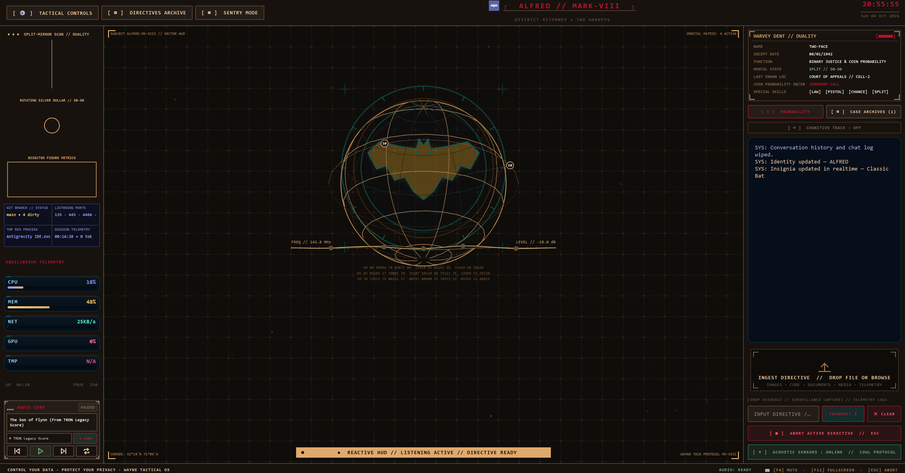

# 🦇 ALFRED — MARK-VIII (Wayne Protocol Edition)
### 🎩 Autonomous Multimodal AI Desktop Assistant & Tactical Terminal
**Version 8 — Stable Build (Windows)** | **Architect & Lead Creator:** **ADITYA MANOJ**

[-00f0ff.svg?logo=windows&logoColor=white)](#)
[-blue.svg?logo=python&logoColor=white)](https://www.python.org/)
[](https://ai.google.dev/)
[](https://ollama.com)
[](https://riverbankcomputing.com/software/pyqt/)
[-00f0ff.svg)](https://github.com/AdityaManojA/ALFRED-MK)
[](https://creativecommons.org/licenses/by-nc/4.0/)

> **ALFRED MARK-VIII (Version 8 — Stable Build · Windows)** is an autonomous, real-time voice, vision, and system-control executive assistant built for complete digital sovereignty and tactical computing. Native bidirectional audio streaming, real-time visual grounding, full desktop automation, high-performance long-term memory, and encrypted mobile remote telemetry — engineered as one of the **most function-dense, production-hardened tactical AI assistants** in the open ecosystem.

<p align="center">
  
</p>

---

## 📑 Table of Contents

1. [🚀 Quick Start & Installation](#quick-start)
2. [🔑 Gemini API Key Setup & Configuration](#gemini-api-key)
3. [🌐 100% Local & Air-Gapped Operation](#local-operation)
4. [🏆 Why ALFRED Outclasses Every Other "Jarvis"](#why-alfred)
5. [🆕 What's New in Version 8 (Stable Build · Windows)](#whats-new)
6. [🎭 Example Tactical Commands](#tactical-commands)
7. [🛡️ Security, Privacy & Defensive Architecture](#security-privacy)
8. [🎙️ Master Voice Command Codex](#voice-codex)
9. [🎧 Real-Time Multimodal Intelligence](#multimodal-intelligence)
10. [🎙️ Custom Wake-Word Neural Network & Multi-Speaker Training](#wake-training)
11. [🎵 Tactical Audio Matrix & Background Score](#tactical-audio)
12. [🎶 Spotify AI Agent](#spotify-agent)
13. [🎬 Visual HUD v2: Embedded Multimedia & Tactical Layering](#visual-hud)
14. [📱 Quantum Mobile Remote & Dashboard](#mobile-remote)
15. [🖥️ Full Desktop Control & OS Automation](#desktop-automation)
16. [🧠 Memory & Briefing Customizer](#memory-briefing)
17. [🎨 Insignia & Chassis Hot-Swapper](#chassis-themes)
18. [⚡ Protocol Engine & Macro Playbooks](#protocol-engine)
19. [👁️ Local Hybrid Visual Grounding](#visual-grounding)
20. [🔊 Audio Ducking & Background Concurrency](#audio-ducking)
21. [🚨 Process Watchdog & Anomaly Detection](#process-watchdog)
22. [🏗️ System Architecture](#system-architecture)
23. [⚙️ Configuration Reference & Hotkeys](#configuration-reference)
24. [🕸️ Knowledge Graph](#knowledge-graph)
25. [👤 Author & Licensing](#author-licensing)

---

<a id="quick-start"></a>
## 🚀 1. Quick Start & Installation

### 📋 Prerequisites
* **Operating System**: **Windows 10/11 (Primary Target — Version 8 Stable Build)**, macOS, or Linux.
* **Python**: **`3.12.x` (Recommended)**. *(Note: Python `3.11` is also supported. Python `3.13` is not recommended due to upstream binary wheel and C-extension compatibility issues with PyAudio, PyQt6, and PyAutoGUI).*
* **Hardware**: Standard microphone and speakers. *No dedicated GPU required — runs on lightweight software rendering.*
* **Intelligence Backend**: Free Gemini API key from [Google AI Studio](https://aistudio.google.com/) **OR** local Ollama / LM Studio.

### ⚙️ Setup & Execution

#### Windows
```powershell
# 1. Clone repository & install dependencies
git clone https://github.com/AdityaManojA/ALFRED-MK.git
cd ALFRED-MK
python setup.py

# 2. Launch ALFRED
python main.py
```

#### macOS (Apple Silicon / Intel)
```bash
# 1. Install prerequisites via Homebrew
brew install yt-dlp ffmpeg portaudio python-tk@3.12

# 2. Clone repository & install dependencies
git clone https://github.com/AdityaManojA/ALFRED-MK.git
cd ALFRED-MK
pip install -r requirements.txt

# 3. Launch ALFRED (zero Ollama required - defaults to Gemini Live)
python main.py
```

#### Linux (Ubuntu / Debian / Fedora / Arch)
```bash
# 1. Install prerequisites
sudo apt install -y python3-pyqt6 python3-tk yt-dlp ffmpeg gstreamer1.0-plugins-good gstreamer1.0-plugins-bad gstreamer1.0-libav xdotool wmctrl playerctl libportaudio2 maim

# 2. Clone & launch
git clone https://github.com/AdityaManojA/ALFRED-MK.git
cd ALFRED-MK
pip install -r requirements.txt
python main.py
```

*On first launch, ALFRED prompts you with the interactive **System Initialisation overlay** to set Operator callsign, Assistant name, and choose between Gemini Live, Local Ollama, LM Studio, or OpenRouter.* For full platform-specific notes, see `docs/crossplatform/SETUP.md`.

---

<a id="gemini-api-key"></a>
## 🔑 2. Gemini API Key Setup & Configuration

ALFRED utilizes **Google Gemini 3.1 Flash Live** for real-time sub-second bidirectional voice and vision streaming. You can obtain a free API key in seconds:

### 🌐 Step-by-Step: Obtaining Your Free Google AI Studio API Key

1. **Visit Google AI Studio**: Go to [https://aistudio.google.com/](https://aistudio.google.com/) in your browser.
2. **Sign In**: Sign in with your standard Google account.
3. **Open API Keys**: Click the blue **"Get API key"** button on the left sidebar (or navigate directly to [https://aistudio.google.com/app/apikey](https://aistudio.google.com/app/apikey)).
4. **Generate Key**: Click **"Create API key"** → select **"Create API key in new project"** (or attach to an existing Google Cloud project).
5. **Copy Your Key**: Copy your generated API key string (starts with `AIzaSy...`).

### ⚙️ Configuring the Key in ALFRED

You can provide your Gemini API key through any of three convenient methods:

#### 1️⃣ Method A: Interactive Graphical Wizard (Recommended)
On first launch (`python main.py`), ALFRED automatically displays the System Initialisation dialog. Simply paste your `AIzaSy...` key into the input field and click **Save & Initialise**.

#### 2️⃣ Method B: Configuration File (`config/api_keys.json`)
Open or edit `config/api_keys.json` and paste your key into the `gemini_api_key` field:
```json
{
    "gemini_api_key": "AIzaSyYOUR_ACTUAL_GEMINI_API_KEY_HERE"
}
```

#### 3️⃣ Method C: System Environment Variable
Set the environment variable in your terminal before starting ALFRED:
```powershell
# Windows PowerShell
$env:GEMINI_API_KEY="AIzaSyYOUR_ACTUAL_GEMINI_API_KEY_HERE"

# Linux / macOS Bash or Zsh
export GEMINI_API_KEY="AIzaSyYOUR_ACTUAL_GEMINI_API_KEY_HERE"
```
*ALFRED automatically detects and prioritizes the `GEMINI_API_KEY` environment variable if present.*

---

<a id="local-operation"></a>
## 🌐 3. 100% Local & Air-Gapped Operation

**ALFRED is architected for dual-backend sovereignty.** Seamlessly toggle between Google's **Gemini 3.1 Flash Live API** (cloud multimodal WebSocket) and **100% local, air-gapped open-weight models** (Ollama, LM Studio, vLLM, Jan, LocalAI, or llama.cpp) without changing a single line of application code.

### 📊 Gemini Live vs. Local Comparison

| Feature | Gemini 3.1 Flash Live | Local (Ollama / vLLM / LM Studio) |
|---|---|---|
| **Audio Latency** | Sub-second native bidirectional WebSocket | Local STT/TTS or text streaming |
| **Privacy** | Encrypted TLS to Google Cloud | 100% offline, zero network egress |
| **Hardware** | Zero local compute | 8 GB–24 GB+ VRAM/RAM depending on model |
| **API Cost** | Pay-per-token / free tier | **$0.00 forever** — unlimited inference |
| **Tool Calling** | Native Gemini AFC | JSON mode or prompt schema |
| **Offline** | Requires internet | **Fully air-gapped** |

### 🔧 Step-by-Step: Switch to Local

#### 🅰️ Option A: Ollama (Simplest)
1. Install from [ollama.com](https://ollama.com/) (macOS 14.0+, Windows, Linux).
   * *Note for macOS 11/12/13 (Big Sur / Monterey / Ventura):* Install the CLI via `brew install ollama` and run `ollama serve`.
2. Pull a model:
   ```powershell
   # 8 GB VRAM (Fast & Accurate):
   ollama pull llama3.2:3b-instruct-q4_K_M
   # 16 GB VRAM (High reasoning):
   ollama pull qwen2.5:7b-instruct
   # Deep programming & tool execution:
   ollama pull deepseek-coder-v2:16b
   ```
3. Daemon runs automatically at `http://localhost:11434`.

#### 🅱️ Option B: LM Studio (GUI Users)
1. Download from [lmstudio.ai](https://lmstudio.ai/).
2. Search and download any quantized GGUF model (e.g., `Qwen2.5-7B-Instruct-GGUF`).
3. Click **Local Server** → set port `1234` → **Start Server**.
4. OpenAI-compatible endpoint live at `http://localhost:1234/v1`.

#### 🅲 Option C: vLLM / llama.cpp (High-Throughput)
```bash
python -m vllm.entrypoints.openai.api_server --model Qwen/Qwen2.5-7B-Instruct --port 8000
```

### 📝 Configuration Templates (`config/api_keys.json`)

**Ollama:**
```json
{
    "llm_provider": "ollama",
    "llm_url": "http://localhost:11434",
    "llm_model": "llama3.2",
    "assistant_name": "ALFRED",
    "user_name": "Master Wayne",
    "ui_color": "#e5a93b",
    "voice_name": "Charon",
    "wake_word_enabled": true,
    "push_to_talk_enabled": true
}
```

**LM Studio / vLLM (OpenAI-Compatible):**
```json
{
    "llm_provider": "openai",
    "llm_url": "http://localhost:1234/v1",
    "llm_model": "qwen2.5-7b-instruct"
}
```

**OpenRouter (Frontier Multi-Model Gateway):**
```json
{
    "llm_provider": "openrouter",
    "openrouter_api_key": "sk-or-v1-YOUR_OPENROUTER_KEY",
    "openrouter_model": "anthropic/claude-3.5-sonnet"
}
```

**Frontier Model Options via OpenRouter:**
* `anthropic/claude-3.5-sonnet` — Deep analytical reasoning
* `google/gemini-2.0-flash-001` — Sub-second speed
* `meta-llama/llama-3.3-70b-instruct` — State-of-the-art open weights
* `deepseek/deepseek-r1` — RL chain-of-thought
* `openai/gpt-4o` — Multi-modal intelligence
* `openrouter/auto` — Dynamic intelligent routing

### 🚀 Launch & Verify

```powershell
python main.py
```

Expected handshake:
```text
[LLM] Connected to local Ollama server at http://localhost:11434 (model: llama3.2)
[Actions] Action discovery complete: 30 active.
```

When offline, ALFRED automatically utilizes `openwakeword` on your local CPU for zero-cloud keyword activation.

### 🔁 Switch Back to Gemini
Add your key to `config/api_keys.json` or set the environment variable:
```powershell
$env:GEMINI_API_KEY="AIzaSyYourActualKeyHere..."
```
ALFRED automatically prioritizes Gemini Live when a valid key is detected.

---

<a id="why-alfred"></a>
## 🏆 4. Why ALFRED Outclasses Every Other "Jarvis"

Most projects branded as "Jarvis clones" ship with a wake word, a chat window, and a handful of shell scripts. **ALFRED MARK-VIII is fundamentally different** — it is a full executive control plane for the operating system, engineered around latency, reliability, structural privacy, and the **sheer density of real, production-hardened functions** it dispatches to your machine.

### 🎯 What "Best-in-Class Optimisation" Actually Means Here

| Pillar | ALFRED MARK-VIII | Typical "Jarvis Clone" |
|---|---|---|
| **Action Surface** | 30+ self-describing, auto-discovered tools (OS, files, vision, music, protocols, sentry, network, windows, clipboard, news, translate, process control, and beyond) | 5–15 brittle, hardcoded scripts |
| **Dual Cognitive Backend** | Gemini Live **or** fully local Ollama / LM Studio / vLLM / OpenRouter — same codebase, single config flip | Cloud-only or local-only |
| **Audio Pipeline** | Live bidirectional stream, PTT, calibrated AEC, speech ducking, PortAudio jitter cushions, explicit `WM_APPCOMMAND` media control (no toggle loops) | Basic `speak()` + default microphone |
| **Visual Grounding** | Local RapidOCR + ONNX first (~75–150 ms), Gemini fallback **only** when confidence is low | Every click = full cloud screenshot |
| **Focus & Sentry** | Dual-mode MONITOR + FOCUS engine, settle rule, deferred lock, floating countdown card, mini-HUD pills, **numeric-only** privacy ledger | Toast notifications, if any |
| **HUD Performance** | Cached CRT layers, batched globe rendering, throttled GC, cached WMI/NVML handles, UI work off Qt timer thread | Frame drops under load |
| **Security Model** | Path guard, Heavenly Restriction, C: drive quarantine, cryptographic confirm gates, universal undo stack, process shields, confirmed shutdown | Hope + system prompt |
| **Mobile Remote** | AES-encrypted local dashboard, QR auto-login, dual-destination screenshots, WebAudio streaming | ngrok demo page |
| **Persona** | Alfred Pennyworth — dignified, dry British wit, in-character error voice, no stack traces | Generic chatbot voice |
| **Music Control** | Dual-tier: Spotify Web API + native OS fallback, debounced anti-loop guards, acoustic feedback elimination | Basic media key spam |
| **Protocols** | YAML compound playbooks with variable interpolation, sleep pacing, path-guarded steps | None |
| **Watchdog** | CPU anomaly detection, socket egress inspection, process throttling, IDE/compiler shields, confirm-gated termination | None |

---

<a id="whats-new"></a>
## 🆕 5. What's New in Version 8 / Mark VIII (Stable Build · Windows)

### 🌐 Cross-Platform Parity (macOS + Linux Architecture)
* **Unified Platform Dispatch (`core/platform/`)**: Centralized OS backend interface providing clean runtime abstraction for windowing flags, master volume (`osascript`, `pactl`, `pycaw`), native TTS fallbacks (`say`, `espeak-ng`), media pause/resume (`playerctl`, AppleScript, `WM_APPCOMMAND`), and screen capture.
* **Mac App Initialisation & Zero-Ollama Default**: Optimized startup overlay for macOS and Linux users to default directly to Google Gemini Live with zero required local compute, avoiding macOS 14+ GUI compatibility blocks on older systems (macOS 11–13).
* **Multimedia Engine Independence**: Validated playback pipelines for AVFoundation (macOS) and GStreamer (Linux) ensuring VP9 video and Opus audio render with zero airspace clipping above Qt widgets.

### 🎬 Visual HUD v2: Embedded Multimedia & Tactical Layering
* **Synchronized Dual-Player Pipeline**: Dual `QMediaPlayer` audio/video synchronization for web streams, preserving native audio tracks unmuted with persistent user volume retention.
* **Win32 HWND Airspace Immunity**: Frameless tool overlays (`make_frameless_overlay`, `Qt.WindowType.Tool`) positioned in global screen space to eliminate Win32 native video viewport occlusion.
* **Zero-Allocation Scrubber & Controls**: Custom-painted timeline (`VideoTimeline`) with click-to-seek, drag-to-scrub with live floating timestamp, and commit-on-release to prevent FFmpeg seek thrashing.
* **Natural Language Voice Time Parser**: Full conversational time parsing (`core/hud_video/mediatime.py`) supporting colons (`"1:10"`), spoken words (`"one minute twenty seconds"`), symbolic landmarks (`"the beginning"`, `"halfway"`), and relative skips (`"forward 30 seconds"`, `"back 10s"`).
* **Hardware AV1 Suppression**: Avoids Windows D3D11 hardware acceleration failures by enforcing VP9 video (`bestvideo[vcodec^=vp9]`) and Opus audio (`bestaudio[acodec^=opus]`), completely eliminating Direct3D11 crash cascades.

### 🛡️ Hardened Safety Interlocks & Anti-Hallucination Guard
* **Confirmed Application Shutdown**: Hardened `shutdown_jarvis` schema with required `confirmation=True` property and anti-hallucination descriptions, permanently preventing accidental exits triggered by speaker music playback, song lyrics, or ambient voice spikes.
* **Acoustic Feedback Elimination**: Strict acoustic isolation and debounced state checks preventing live Spotify or media output from self-triggering duplicate tool calls.

### 🛡️ Sentry Mode v2: Dual-Mode Surveillance & Distraction Defense
* **Dual-Mode Architecture**: Replaced single-terminal screen checks with an extensible vigilance architecture coordinated by `core/sentry/mode_manager.py`.
* **MONITOR Mode (Passive Surveillance)**: Generalized across 5 targets (`terminal`, `build`, `download`, `test`, `screen`) to observe long-running external work without polling loops. Features an 8-second conversational `AnswerWindow` for seamless STT un-gating upon task completion or anomaly alerts.
* **FOCUS Mode (Proactive Distraction Defense)**: Independent 1 Hz session loop (`core/sentry/focus/engine.py`) locking onto specific applications or browser tabs. Features an 800 ms grace window, 3 progressive escalation tiers, and customizable cadences (`normal`, `gentle`, `drill_sergeant`).
* **Ergonomic Settle Rule & Deferred Lock**: Start focus sessions directly from the HUD or voice without locking onto ALFRED itself. Waits 2 consecutive ticks on the user's active work surface before locking (*"Locked on, sir."*), with automatic fallback to application-only lock after 45 seconds on home base.
* **Floating Desktop Countdown Card**: High-tech 170×48 px translucent draggable widget (`core/sentry/focus/card.py`) with cyan progress arc ring, digital `mm:ss` timer, pulsing red excursion warning border, screen-boundary clamping, and right-click tactical context menu.
* **Spoken Report Card & Structural Privacy Ledger**: Delivers spoken completion summaries with clean streak tracking, atomically persisting strictly numeric totals to `data/focus_ledger.json`. Zero URLs, window titles, or private strings are ever stored or logged.

### 🎙️ Custom Wake-Word Neural Network & Multi-Speaker Training Pipeline
* **OpenWakeWord ONNX Fine-Tuning**: Complete offline acoustic model training pipeline allowing operators to train custom `alfred.onnx` models specialized to their voice, secondary operators (e.g., friend/family), and ambient room noise.
* **Hybrid Google Colab & Local IDE Notebook**: Shipped `train_alfred_colab.ipynb` for cloud GPU/CPU training with automated active-kernel package management, audio augmentation, and transfer learning from baseline weights.
* **Multi-Speaker Dataset Recorder & Packager (`tools/record_training_samples.py`)**: Interactive CLI tool for recording positive utterances per speaker, negative room noise/speech, auto-zipping datasets (`--zip`), and direct local PyTorch-to-ONNX compilation (`--train-local`).
* **Personal Biometric Voice Verifier (`tools/train_personal_verifier.py`)**: Lightweight voice classifier generating `models/alfred_verifier.pkl` to gate wake activations strictly to authorized voices.
* **Dual-Phrase Gating & Real-Time Acoustic HUD (`tools/test_wake_model.py`)**: Dual-phrase architecture ("Hey Alfred" >= 0.70, "Alfred" >= 0.85) with `GATE_TTS` acoustic shielding, 1500 ms refractory suppression, and live console VU meter testing.

### 🎵 Tactical Audio Core Voice Control
Introduced dedicated `actions/audio_core.py` action tool and UI methods (`pause_audio_core`, `resume_audio_core`), allowing users to control the ambient TRON Legacy score directly (*"pause audio core"*, *"resume audio core"*, *"audio core volume to 25%"*) without conflicting with Spotify routing.

### 🎧 Audio & Microphone Stability Overhaul
* **Audio Starvation Fix**: Reconfigured `sd.RawOutputStream` in `main.py` with `blocksize=0` for hardware-native buffer sizing, dynamic jitter pre-buffering on utterance starts, and a 3-count debounce grace period on `is_speaking`.
* **News Reading Interruption Leak Elimination**: Strict cancellation flags (`self._briefing_cancelled = True`) and active background task cancellation. Interrupting ALFRED during morning briefings now instantly silences playback.

### 🎶 Spotify Anti-Loop & Feedback Elimination
* **Toggle Inversion Fix**: Replaced blind `VK_MEDIA_PLAY_PAUSE (0xB3)` toggle with explicit Windows `WM_APPCOMMAND` messages (`APPCOMMAND_MEDIA_PAUSE=47`, `APPCOMMAND_MEDIA_PLAY=46`), eliminating recursive play/pause loops.
* **Acoustic Feedback Elimination**: Decoupled synchronous TTS `speak()` calls from `actions/spotify_control.py`, preventing self-triggered duplicate tool calls.

### 📱 Mobile Remote Uplink & Dashboard Repair
* **Tuple Unpacking Bug Fix**: Eliminated defect in `MainWindow._open_remote` where return tuple reassignment corrupted QR code, coordinates, desktop link, and key.
* **Clickable Hyperlinks & Browser Launch**: Upgraded `RemoteKeyOverlay` with `Qt.TextInteractionFlag.LinksAccessibleByMouse` and rich HTML anchors. Added an **`↗ OPEN IN BROWSER`** button for instant one-click dashboard launching.
* **Instant Camera Pairing**: Configured `main.py` (`_make_remote_key`) to pass full `/auto-login?key={key}` paths to both LAN and localhost links for seamless mobile QR pairing.

### ⚡ Performance & 30-Second Frame Drop Elimination
* **COM & NVML Driver Handle Caching**: Prevented periodic 40–100 ms thread hangs during metric polling by persisting `wmi.WMI` COM namespaces and `pynvml.nvmlInit()` GPU device handles across calls.
* **Qt UI Thread Offload**: Decoupled heavy OS process counting and boot time queries from Qt's 500 ms main timer thread, shifting them to background `_SysMetrics` daemon to lock GUI at consistent 60 FPS.
* **PortAudio Jitter Cushion**: Configured PortAudio output with `latency="high"` and elevated utterance start pre-buffering to 250 ms, absorbing Windows thread scheduling delays.
* **Python GC Throttling**: Raised GC generation 0/1/2 collection thresholds to `(70000, 15, 15)` to avoid stop-the-world garbage collection pauses.

### 🎨 Reactive HUD Frame Pacing
* **Static Layer & Crest Caching**: The CRT grid, scanline/reticle overlay, and scaled Wayne crest are rendered once per size/theme and reused. Full-canvas cache bounded to 8 entries.
* **Batched Vector Globe Rendering**: More than 1,000 per-segment `QPen` and `drawLine` operations consolidated into depth-grouped `drawLines` batches while preserving front/back illumination, orbital motion, speech reactivity, and plosive flashes.
* **📊 Benchmarked Result**: Warm HUD frame fell from approximately **125 ms → 22 ms**, while repeated Configure refresh work fell from approximately **3.5 ms → 0.66 ms**.

---

<a id="tactical-commands"></a>
## 🎭 6. Example Tactical Commands — "Wayne Protocol" in Action

### 🎩 Distinguished Butler & Persona Banter
* *"Good morning, Alfred."* → Executive morning greeting with weather.
* *"Alfred, how do you look today?"* → *"I find my holographic profile impeccably groomed today, sir..."*
* *"Alfred, give me some advice."* → *"Might I suggest, sir, that sleep is occasionally an acceptable substitute for caffeine?"*
* *"Who is Batman?"* → Discreet, knowing butler response protecting your secret identity.
* *"Alfred, tell me a joke."* → Understated dry British wit.

### 👁️ Tactical Vision & Screen Grounding
* *"Look at my screen and tell me why this code isn't compiling."* → Captures active IDE, analyzes stack trace, explains the bug.
* *"Look at my webcam, how do I look?"* → Situational webcam snapshot with candid opinion.
* *"Click that green button on the screen."* → Local RapidOCR/ONNX grounding (<150 ms) → instant click.
* *"Take a screenshot and beam it to my phone."* → Simultaneously saves PNG to Desktop and pushes preview + download link to mobile.

### 🎵 Ambience & Entertainment
* *"Alfred, set the mood."* / *"Restore TRON music."* → Resumes Daft Punk's *Son of Flynn* with speech ducking.
* *"Audio core volume to 20%."* → Calibrates background score gain.
* *"Play Starboy on Spotify."* → Transitions from ambient score to Spotify streaming.
* *"Pause the music, Alfred."* → Explicit hardware OS pause command.

---

<a id="security-privacy"></a>
## 🛡️ 7. Security, Privacy & Defensive Architecture

* **🚫 The Heavenly Restriction**: ALFRED is strictly and irrevocably forbidden from accessing, opening, reading, listing, modifying, or executing files inside `D:\Projects\Personal-Assistant` and all subpaths.
* **🔐 C: Drive Quarantine**: File manipulation on `C:` is strictly confined to **Desktop** and **Documents**. Any attempt to touch `C:\Windows`, `C:\Program Files`, `Downloads`, `AppData`, or root is permanently blocked.
* **💾 Safe Storage Zones**: `D:` and `E:` drives are designated safe zones (with `D:\Projects\Personal-Assistant` permanently locked).
* **Human Confirmation Gate**: Destructive operations (shutdown, reboot, WiFi toggle) generate a cryptographic on-screen confirmation button.
* **Universal Undo Stack**: *"Undo"*, *"revert that"*, *"put it back"* rolls back file creations, moves, renames, writes, and settings changes.

---

<a id="author-licensing"></a>
## 👤 25. Author & Licensing

* **🎩 Lead Architect & Creator:** **ADITYA MANOJ**
* **🦇 Project:** ALFRED-MK-VIII — Version 8 (Stable Build · Windows, Wayne Protocol Edition)
* **📜 License:** [Creative Commons Attribution-NonCommercial 4.0 International (CC BY-NC 4.0)](https://creativecommons.org/licenses/by-nc/4.0/)

---

*⚡ Built with precision for autonomy, performance, and complete digital sovereignty — the most function-dense, optimisation-conscious open tactical assistant in the Wayne-protocol class.*
